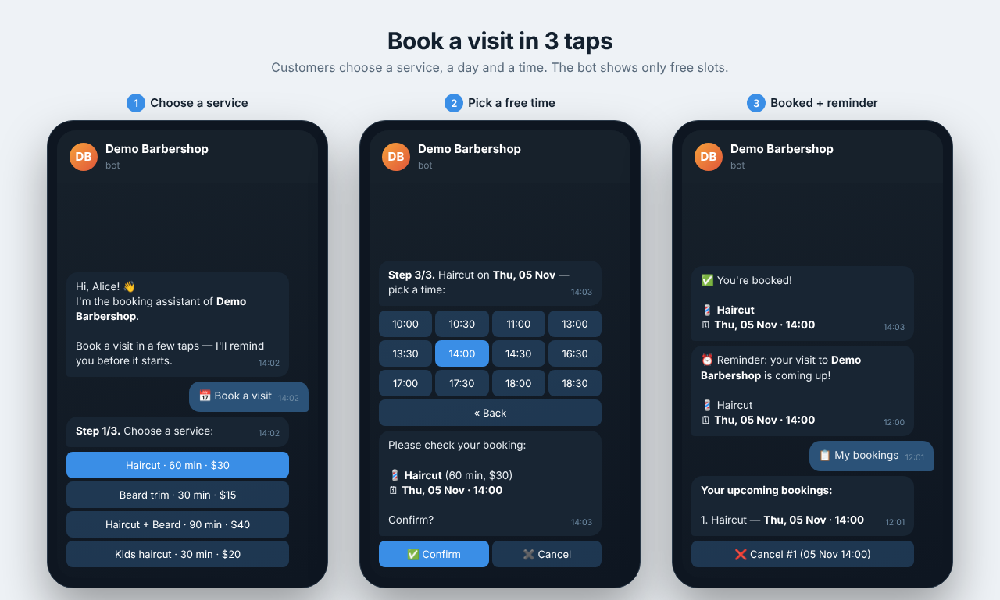
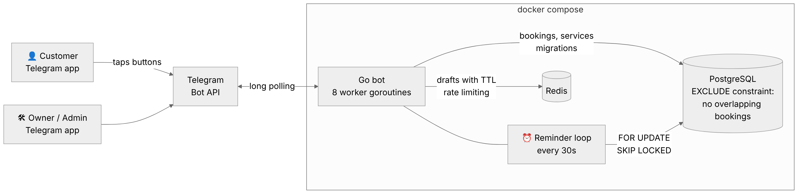

# 📅 Telegram Booking Bot (Go)

[](https://github.com/yourname/tg-booking-bot/actions/workflows/ci.yml)


A production-ready **appointment booking bot** for small service businesses: barbershops, beauty salons, tutors, clinics, car services.
Customers book a visit in three taps, get a reminder before it starts and can cancel on their own. The owner gets instant notifications and a daily schedule, all inside Telegram.



## Features

**For customers**
- 3-step booking: service → day → time. The bot shows **only free slots**, calculated from each service's duration.
- Automatic reminder before the visit (configurable, 2 h by default).
- "My bookings" with one-tap cancellation.
- Price list and opening hours.

**For the business owner**
- Instant notification about every new booking or cancellation.
- Schedule for today / tomorrow / the next 7 days, with cancel buttons. The customer is notified automatically.
- Services, prices, working hours, slot step and time zone are configurable without code changes.

**Under the hood**
- **Double bookings are impossible.** A PostgreSQL `EXCLUDE USING gist` constraint rejects overlapping visits at the database level, even when two customers press "Confirm" at the same moment. This is covered by a test that fires 20 concurrent bookings at one slot.
- **Never trusts the client.** Callback data is re-validated on confirmation (working hours, slot grid, future time).
- **Redis** holds in-progress booking drafts (expire after 15 min) and a per-user rate limiter against button spam.
- **Reminder loop** claims reminders with `FOR UPDATE SKIP LOCKED`, so several replicas never send duplicates.
- A worker pool processes updates concurrently. Shutdown is graceful (SIGTERM waits for in-flight updates).
- Embedded SQL migrations guarded by an advisory lock, so the bot ships as a single binary.
- Structured JSON logs (`log/slog`), a distroless non-root image of about 10 MB, and healthchecks in compose.

## Architecture



```
cmd/bot/              entrypoint, wiring, worker pool, graceful shutdown
internal/
  bot/                Telegram handlers: booking flow, my bookings, admin, reminders
  scheduling/         pure slot-calculation logic (no I/O, fully unit-tested)
  storage/postgres/   repository, migrations runner
  storage/redisstore/ drafts with TTL, rate limiter
  config/             env-based configuration with validation
  domain/             core types and errors
migrations/           SQL schema (embedded into the binary)
```

Handlers depend on small interfaces (`Repository`, `SessionStore`, `Sender`), so the whole booking flow is tested with in-memory fakes and needs no Telegram, Postgres or Redis.

## Quick start

1. Create a bot with [@BotFather](https://t.me/BotFather) and copy the token.
2. Find your Telegram user ID (for example via [@userinfobot](https://t.me/userinfobot)). It becomes the admin.
3. Run:

```bash
git clone https://github.com/yourname/tg-booking-bot.git
cd tg-booking-bot
cp .env.example .env      # put BOT_TOKEN and ADMIN_IDS here
docker compose up -d --build
```

That's it. Postgres, Redis and the bot start together, and the schema plus demo services are created automatically.

## Configuration

| Variable | Default | Description |
|---|---|---|
| `BOT_TOKEN` | — | Token from @BotFather (**required**) |
| `DATABASE_URL` | — | Postgres DSN (set automatically in compose) |
| `REDIS_URL` | `redis://localhost:6379/0` | Redis URL |
| `ADMIN_IDS` | — | Comma-separated Telegram IDs of admins |
| `BUSINESS_NAME` | `Demo Barbershop` | Shown in greetings and reminders |
| `TIMEZONE` | `UTC` | IANA zone, e.g. `Europe/Berlin` |
| `WORK_START_HOUR` / `WORK_END_HOUR` | `10` / `20` | Opening hours |
| `SLOT_STEP` | `30m` | Grid of possible start times |
| `BOOKING_DAYS` | `7` | How far ahead customers can book |
| `REMINDER_LEAD` | `2h` | When to send the reminder |

Services live in the `services` table. Edit `migrations/002_seed_services.sql` before the first run, or update the table directly.

## Testing

```bash
make test               # unit tests: slot logic + full booking flow with fakes
make test-integration   # + real PostgreSQL and Redis in throwaway containers
```

Integration tests cover the overlap constraint, 20 concurrent bookings of the same slot (exactly one wins), owner checks on cancellation, exactly-once reminder claiming, and idempotent migrations. CI runs everything on every push, with the race detector enabled.

## Deploying to a VPS

Any $5 VPS with Docker is enough:

```bash
ssh user@your-server
git clone ... && cd tg-booking-bot && cp .env.example .env && nano .env
docker compose up -d --build
docker compose logs -f bot
```

The bot uses long polling, so it needs **no domain, no open ports and no SSL**. Containers restart automatically after a reboot.

## Customization ideas

Several staff members with their own schedules · Google Calendar sync · online prepayment (Telegram Payments / Stripe) · a web admin panel · multi-language texts (all strings are in `internal/bot/texts.go`).

---

Need a bot like this for your business? **[Contact me on Fiverr](https://www.fiverr.com/yourname)**.
